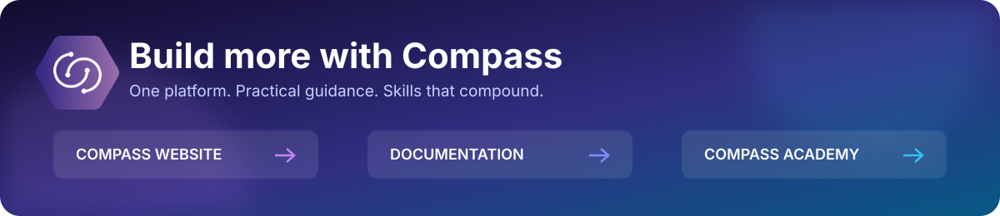

  
   
  <strong><a href="https://www.compassap.ai/">Compass Website</a> · <a href="https://www.compassap.ai/docs">Compass Documentation</a> · <a href="https://www.compassap.ai/academy">Compass Academy</a></strong>

# Nova Echo

**Give your computer a task in plain words. Nova Echo brings Compass chat, voice conversations, and permission-controlled computer actions into a desktop app.**

[Download Nova Echo](../../releases) · [Report a bug](../../issues) · [Suggest a feature](../../issues)

---

## An assistant that works with your desktop

Ask a question, share your screen when useful, or ask Nova to help with a task on your computer. Follow its actions in the activity panel and choose which permissions to allow.

| What you can do | How it helps |
| --- | --- |
| **Chat with Compass** | Describe a task, ask questions, and follow up in the same conversation. |
| **Talk naturally** | Start a voice conversation, hear spoken replies, and interrupt speech when needed. |
| **Share your screen when you choose** | Let Nova use screenshots to understand what is on your primary display. |
| **Work with desktop apps** | Allow mouse, keyboard, and window actions to help carry out your task. |
| **Open the right thing** | Open applications, web links, and supported local documents within your configured allowed folders. |
| **Use Compass tools** | Access tools such as web search, knowledge bases, Microsoft 365, and document generation when available to your account. |
| **Control permissions** | Deny an action, allow it once, or remember supported choices; review and revoke saved permissions in Settings. |
| **Follow progress** | See tool activity and stop running work from the app. |

## Get started

### 1. Install Nova Echo

Open the [releases page](../../releases) and check for a Windows x64 installer. Download only assets attached to a published Nova Echo release and follow its release notes. This repository does not itself establish that an installer has been published. macOS is not included in the current Windows release scope.

Published installers bundle the computer-control runtime. You do not need to install Node.js, Rust, or developer tools to use the app.

### 2. Connect Compass

Open **Settings**, enter your Compass API key, and choose a model enabled for your account. Save to verify the key. Your available models and tools depend on your Compass account and organisation.

Nova Echo requires an internet connection for Compass inference and services. It is not an offline transcription app and does not require a local speech-model download.

### 3. Choose your permissions

Screen sharing and computer input are separate controls. Enable **Allow screen capture** only when you want screenshots used for reasoning. Review action prompts before permitting computer control.

Supported prompts offer **Deny**, **Allow once**, and **Allow always**. You can also allow routine computer actions for the current task. Sensitive operations still require specific confirmation; remembered permissions are not blanket authorisation. Review **Remembered permissions** and allowed folders in Settings to revoke access or change what Nova can open.

### 4. Type or speak a task

Start with something concrete, such as “Describe what is on my screen” or “Find the window I need.” Use the microphone button to **Start voice conversation**. The microphone stays active across replies until you end the conversation. Spoken follow-ups during work wait for the current task; they do not redirect it.

Use **Stop** to cancel running work. Ending voice turns off the microphone but does not cancel a task already running. Stopping cannot undo completed actions or close applications that have already been opened.

## What leaves your computer

Nova Echo uses cloud services through Compass. Task context and screenshots shared for reasoning pass through Compass to model services. During a voice conversation, microphone audio, including pauses and background sound, and spoken replies pass through Compass to OpenAI. The app does not save a local audio recording of that conversation.

On Windows, your Compass API key is stored in Windows Credential Manager, not in browser storage. Settings are saved locally. Connected Compass tools may read or change information in external services according to your account access and approvals.

Only share screens and content you are authorised to disclose. Nova uses AI and can make mistakes. Review important results and sensitive actions; permission prompts do not guarantee that every consequence will be recognised correctly.

## Updates

The Windows app checks for updates at startup and offers manual checking in **Settings**. You review release notes, download the update, and choose **Install update** separately. Installation is blocked while tasks or voice sessions are active. Until a published feed is available, an update-check error does not mean the app cannot be used.

## Questions before you start

**Can it open any file or run arbitrary commands?**

No. Local document opening is restricted to configured allowed folders and supported targets. Permission to control the desktop is not unrestricted filesystem or shell access.

**Does it work on macOS or Linux?**

This repository currently targets Windows x64 distribution. macOS publishing is deferred; no macOS or Linux release is promised here.

## Feedback and ideas

[Open an issue](../../issues) with your app version, Windows version, what happened, and what you expected. For feature requests, describe the task you want to accomplish.

Do not include API keys, private screenshots, voice content, confidential documents, or other sensitive information in public issues. Redact any logs or error messages before posting.

## About this repository

This is the public home for Nova Echo downloads, release notes, and feedback. The application source is maintained separately; a local `nova-echo/` source checkout is ignored and must not be published with this repository.

The scripts and release-hash workflow calculate installer SHA-256 hashes and sizes. The root `latest.json` is that checksum catalogue, not the app's signed update feed. Its platform list stays empty until real Echo release assets are available; never reuse another product's hashes or signatures.

For in-app updates, publish the **signed `latest.json` generated by the Echo application build** as a release asset, alongside its installer, `.sig`, and `SHA256SUMS`. The app reads the release asset, not this repository's root checksum catalogue. Do not replace the signed feed with hash-workflow output or modify installer bytes after signing.

## License

[MIT](./LICENSE) © 2026 Brighten SA.
